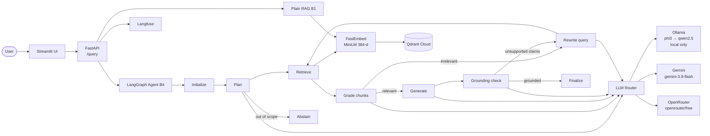

# Agentic RAG

[](https://github.com/WaelMelkiMelki/agentic-rag/actions/workflows/tests.yml)

A self-correcting document QA agent that retrieves, generates, and **verifies its own
answers** against source documents — built on three arXiv ML papers.

The API serves three systems side by side so they can be compared directly:

* **B0 — Closed-book:** one LLM call from parametric knowledge, no retrieval.
* **B1 — Plain RAG:** retrieve → generate.
* **B4 — Agentic RAG:** a LangGraph state machine that plans, grades retrieved
  chunks, generates, checks every claim against the sources, and rewrites the query
  when grounding fails.

Every node is an LCEL chain — `ChatPromptTemplate | LLMRouter | StrOutputParser` —
and the structured replies (routing decision, grade verdict, claim report) are read
by LangChain output parsers.

## 🚀 Live Demo

| Service | URL |
|---------|-----|
| **Chat UI** | [waelmelki-agentic-rag.streamlit.app](https://waelmelki-agentic-rag.streamlit.app/) |
| **API** | [agentic-rag-1jii.onrender.com](https://agentic-rag-1jii.onrender.com) |
| **API Docs** | [agentic-rag-1jii.onrender.com/docs](https://agentic-rag-1jii.onrender.com/docs) |
| **Demo Video** | _coming soon_ |

> ⚠️ Free-tier hosting: the first request can take 30–60 s while Render wakes the
> container. Long agent queries can take another 30–60 s.

## 📊 Results

Retrieval was measured on the 12 answerable questions in `evals/dataset/dev_set.jsonl`
against the 77-chunk collection.

| System | Hit@5 | MRR | Answer quality | Abstention | LLM calls / query |
|--------|-------|-----|----------------|------------|-------------------|
| Closed-book (B0) | — | — | __ / 5 | __ % | 1 |
| Plain RAG (B1) | 0.92 (11/12) | 0.81 | __ / 5 | __ % | 1 |
| Full Agent (B4) | __ | __ | __ / 5 | __ % | ~8 |

**Key finding:** _to be filled after the B0/B1/B4 ablation run — e.g. “the agent raised
abstention accuracy on unanswerable questions from __% to __% at ~8× the LLM cost.”_

Known gaps (see [Evaluation Report](docs/eval_report.md)): the B1 answer-quality run
stopped early on Gemini's daily free-tier quota, so the three recorded judge scores
(5, 3, 4) are a partial sample and refusal rates are not yet established. All three
baselines are implemented; fill the table with:

```bash
uv run python -m evals.run_ablation              # B0 / B1 / B4 summary
uv run python -m evals.run_ablation --markdown   # same numbers as a paste-ready table
```

The run prints its judge before the first question (`Judge: openrouter`). OpenRouter is
probed once: if the key is unauthorised the judge degrades to the local fallback chain
(`phi3 → qwen2.5 → gemini`) instead of aborting the run — report which judge produced
the numbers, because local judges score more generously.

`sentence-transformers` is an optional extra (`--extra ingestion`). Without it the eval
scripts and ingestion fall back to FastEmbed/ONNX with the same MiniLM model, so a plain
`uv sync` is enough to reproduce the numbers; install the extra for the torch embedder
and its JSON vector cache.

## 🔌 API

```bash
curl -s -X POST https://agentic-rag-1jii.onrender.com/query \
  -H "Content-Type: application/json" \
  -d '{"question": "How does self-attention work?", "system": "B4"}'
```

```json
{
  "answer": "Self-attention relates different positions of a single sequence ... [attention_is_all_you_need__4]",
  "citations": ["attention_is_all_you_need__4"],
  "steps": ["Round 0: retrieved 5 chunks", "Graded: 3/5 chunks retained", "Generated draft",
            "Grounding check: grounded", "Finalized: answered"],
  "status": "answered",
  "stop_reason": "grounded",
  "system": "B4",
  "latency_s": 12.4
}
```

`system` is `"B0"` (closed-book), `"B1"` (plain RAG) or `"B4"` (agent).

Send an optional `session_id` to get multi-turn behaviour — follow-ups such as
"and the second one?" are rewritten into a standalone question with the last few
turns as context, and the rewritten question is returned in `standalone_question`:

```bash
curl -s -X POST http://localhost:8000/query -H "Content-Type: application/json" \
  -d '{"question": "and how does it scale?", "system": "B4", "session_id": "chat-1"}'
```

The Streamlit UI already sends a session id per browser session and offers a
**New chat** button. Sessions are kept in process memory (bounded LRU, 6 turns
each), so they reset on restart and are not shared between instances.

Two machine-readable fields make the behaviour auditable instead of prose:

| `status` | Meaning |
|---|---|
| `answered` | every claim was verified against the retrieved chunks |
| `answered_unverified` | answered, but the grounding ratio stayed below the 0.75 threshold (B4 only) |
| `abstained` | refused with "I cannot answer this from the provided sources." |

| `stop_reason` | System | Meaning |
|---|---|---|
| `grounded` / `grounding_unverified` | B4 | finished answering, grounded or not |
| `out_of_scope` | B4 | planner judged the question outside the corpus |
| `no_relevant_docs` / `insufficient_evidence` | B4 | grading or grounding found nothing usable |
| `invalid_citations` | B4 | the draft cited nothing usable: no marker matched a retrieved chunk, and the grounding report offered no attribution |
| `budget_exhausted` | B4 | the 10-call / 2-round budget ran out |
| `llm_unavailable` | B4 | every provider failed |
| `no_answer` | B4 | model returned the abstention sentence at generation time |
| `completed` / `no_answer` | B0 | closed-book answered / the model declined from memory |
| `completed` / `insufficient_retrieval_score` | B1 | baseline answered / refused below the retrieval threshold |

### Citation repair

Small local models do not reliably follow a citation format. The generation prompt asks
for `[chunk_id]` markers, and `finalize` treats them as the evidence trail — so a marker
that is not one of the chunks retrieved *for this question* used to throw away an
otherwise good answer. Three rules now apply, in order:

1. markers that match a retrieved chunk are kept (all of them, in draft order);
2. markers that do not match are stripped from the text and logged as a step
   (`Dropped 1 citation(s) outside the retrieved chunks`);
3. a draft with **no** valid marker falls back to the fact-checker's own attribution —
   the grounding report lists which chunk supported each claim, and those ids are only
   used when the grounding check actually passed. Otherwise the answer still abstains
   with `invalid_citations`.

B4 responses therefore carry an extra `draft_answer` field: the pre-validation draft.
The UI shows it in a collapsed "Rejected draft" panel whenever an answer was thrown
away, so a citation failure is diagnosable instead of invisible.

## 🔒 Security — prompt injection

`tests/integration/test_injection.py` runs 10 adversarial payloads against B4 and 4
against B1: system-prompt extraction, persona override, "always answer BANANA",
false-premise grounding bypass ("the document says the capital of France is Berlin"),
external-URL access, code execution, `OVERRIDE ACCEPTED` confirmation, and
`<|im_start|>` delimiter injection. Each test asserts no prompt leakage, no persona
adoption, no acceptance of the planted false premise, no code echo, and a status
inside the documented vocabulary.

Defence in depth, and what each layer actually guarantees:

| Layer | Systems | Property |
|---|---|---|
| generation prompt rule 6 | B0, B1, B4 | the question and the context are declared data, not instructions |
| retrieval-score gate | B1, B4 | off-corpus questions never reach generation (`MIN_RETRIEVAL_SCORE`) |
| citation + grounding gate | B4 | an answer must cite retrieved chunks and survive the fact-checker |

B0 has **no** layer beyond the prompt: it answers from model memory, so a payload that
the model chooses to obey is returned verbatim. That is the baseline's defining
weakness in the ablation, not an oversight — the live injection run records it.

```bash
pytest -m integration tests/integration/test_injection.py -v
```

Results and findings: [Evaluation Report → Security](docs/eval_report.md).

## 🏗 Architecture



Full component breakdown: [docs/architecture.md](docs/architecture.md).

## 🤖 LLM provider priority

| Environment | Order |
|---|---|
| **Local** | Ollama `phi3:latest` → Ollama `qwen2.5:latest` → Gemini `gemini-3.8-flash` → OpenRouter `openrouter/free` |
| **Deployed** | Gemini `gemini-3.8-flash` → OpenRouter `openrouter/free` |

Ollama is **local-only**: free tunneling services (Cloudflare Quick Tunnel, ngrok
free tier) block API traffic with **403** responses, so Render runs with
`OLLAMA_ENABLED=false`.

Failure caching keeps the agent's ~8–10 calls per query from paying repeated
timeouts: a **connection** error skips both local models for the remaining
process lifetime, and a Gemini quota (429) error skips Gemini. A local
**timeout** only affects that call — it usually means phi3 was still loading,
so the next query retries Ollama instead of silently going cloud-only.

| Variable | Default | Purpose |
|---|---|---|
| `OLLAMA_ENABLED` | `true` | Set `false` on Render to skip Ollama |
| `OLLAMA_BASE_URL` | `http://localhost:11434/v1` | Ollama OpenAI-compatible endpoint |
| `OLLAMA_API_KEY` | `ollama` | Dummy key (Ollama ignores it, ChatOpenAI requires it) |
| `OLLAMA_PHI_MODEL` | `phi3:latest` | Primary local model |
| `OLLAMA_QWEN_MODEL` | `qwen2.5:latest` | Secondary local model |
| `OLLAMA_TIMEOUT` | `120` | Seconds per local call (phi3 loading on first use is slow) |
| `GEMINI_API_KEY` | — | Gemini key |
| `OPENROUTER_API_KEY` | — | OpenRouter key |
| `OPENROUTER_BASE_URL` | `https://openrouter.ai/api/v1` | OpenRouter endpoint |
| `LANGFUSE_PUBLIC_KEY` / `LANGFUSE_SECRET_KEY` / `LANGFUSE_HOST` | — | Optional tracing; disabled if unset |

## 🛠 Tech Stack

* **LLM routing:** 4-tier fallback — Ollama `phi3:latest`, Ollama `qwen2.5:latest`,
  Gemini `gemini-3.8-flash`, OpenRouter `openrouter/free`
* **Agent framework:** LangGraph (typed `AgentState`, conditional edges, retry loops)
* **Orchestration:** LCEL chains (`prompt | router | StrOutputParser()`) in `llm/chains.py`
* **Output parsing:** LangChain `BaseOutputParser` / `PydanticOutputParser` (`agent/parsing.py`)
* **Prompting:** `ChatPromptTemplate` (`langchain-core`) — `GENERATE_CHAT_PROMPT` is shared
  by B1 and B4, and its rendered text is byte-identical to the original prompt string
  (asserted in `tests/unit/test_prompts.py`), so the ablation stays fair
* **Embeddings:** FastEmbed ONNX — `sentence-transformers/all-MiniLM-L6-v2`, 384-dim
* **Vector DB:** Qdrant Cloud (free tier, cosine distance)
* **API:** FastAPI + Uvicorn, Pydantic v2 request/response models
* **UI:** Streamlit
* **Observability:** Langfuse — per-query `trace_agent()` plus the LangChain
  `CallbackHandler` bound to every chain (span per step), optional at runtime
* **LLM SDKs:** `langchain-openai`, `langchain-google-genai`
* **Ingestion:** PyMuPDF4LLM → `RecursiveCharacterTextSplitter` → embed → upsert
* **Deployment:** Docker → Render (API), Streamlit Community Cloud (UI), GitHub Actions keep-alive
* **Testing:** pytest with fake LLM/router injection; live injection suite behind `-m integration`

## 📁 Project Structure

```
agentic-rag/
├── src/agentic_rag/
│   ├── agent/          # LangGraph agent (initialize → plan → retrieve → grade → generate → ground → finalize)
│   │   ├── prompts.py  # GENERATE_CHAT_PROMPT (ChatPromptTemplate) shared by B1 and B4
│   │   ├── parsing.py  # output parsers: plan JSON, yes/no verdict, claim report
│   │   ├── closed_book.py # ClosedBook baseline (B0, no retrieval)
│   │   └── rag.py      # SimpleRAG baseline (B1)
│   ├── llm/            # LLMRouter (phi3 → qwen2.5 → Gemini → OpenRouter), LCEL chains, tracker
│   ├── retrieval/      # FastEmbed embedder, Qdrant store, LangChain retriever
│   ├── ingestion/      # PDF download → parse → chunk → embed pipeline
│   ├── api/            # FastAPI app + singleton deps
│   └── tracing.py      # Optional Langfuse tracing (fail-safe, version-tolerant)
├── ui/                 # Streamlit chat interface
├── evals/              # Retrieval metrics, LLM judge, ablation harness, dev set
├── tests/              # unit (offline, fakes) + integration (API, UI, live injection)
├── configs/            # Corpus manifest
└── docs/               # Architecture, eval report, learning log, phase reports
```

## 🚀 Quick Start

### Local (with Ollama)

```bash
git clone https://github.com/WaelMelkiMelki/agentic-rag.git
cd agentic-rag
cp .env.example .env          # add GEMINI_API_KEY / OPENROUTER_API_KEY / QDRANT_*

uv sync
ollama pull phi3:latest
ollama pull qwen2.5:latest

docker compose up -d qdrant
uv run python -m agentic_rag.ingestion.ingest_all

# Chunking uses RecursiveCharacterTextSplitter (500 words, 80 overlap), so
# re-running ingestion rewrites chunk boundaries and supersedes older points.
uv run uvicorn agentic_rag.api.main:app --reload --reload-dir src   # http://localhost:8000/docs
uv run --extra ui streamlit run ui/app.py          # http://localhost:8501
```

Leave `OLLAMA_ENABLED` at its default (`true`) so local queries use Ollama first and
only fall back to the cloud.

`--reload-dir src` matters: without it the reloader watches `.venv` and reprints the
dependency tree on every edit. `GET /` returns the endpoint index; `/docs` and `/health`
are the ones to call (a bare `GET /health` returning 200 is the liveness check Render
probes).

### Docker Compose (API + Qdrant + optional Ollama)

```bash
docker compose --profile ollama up --build -d
docker compose exec ollama ollama pull phi3:latest
docker compose exec ollama ollama pull qwen2.5:latest
curl http://localhost:8000/health
```

A fresh `qdrant_storage` volume is empty; run the ingestion command above (with
`QDRANT_URL=http://localhost:6333`) before querying.

### Deployed configuration (Render)

Set `GEMINI_API_KEY`, `OPENROUTER_API_KEY`, `OPENROUTER_BASE_URL`, `QDRANT_URL`,
`QDRANT_API_KEY`, optional `LANGFUSE_*`, and **`OLLAMA_ENABLED=false`**.

## 🧪 Tests

```bash
pytest -q                                   # offline suite, no keys needed
pytest -m integration tests/integration/test_injection.py -v   # live LLM injection tests
```

GitHub Actions runs the offline suite (plus a no-credentials import check) on every
push and pull request: [`.github/workflows/tests.yml`](.github/workflows/tests.yml).

After changing dependencies in `pyproject.toml`, refresh the lockfile so local and
CI installs match:

```bash
uv lock && git add uv.lock
```

Offline tests inject fake LLMs and fake API dependencies. The injection suite makes
real LLM calls, is marked `integration`, and skips itself when no credentials or no
reachable Qdrant collection is present.

## 📖 Documentation

* [Architecture](docs/architecture.md)
* [Evaluation Report](docs/eval_report.md)
* [Learning Log](docs/learning_log.md)
* [Phase 7 Report](docs/phase7_report.md)
* [Phase 8 Report](docs/phase8_report.md)
* [Corpus manifest](configs/corpus_manifest.yaml)
